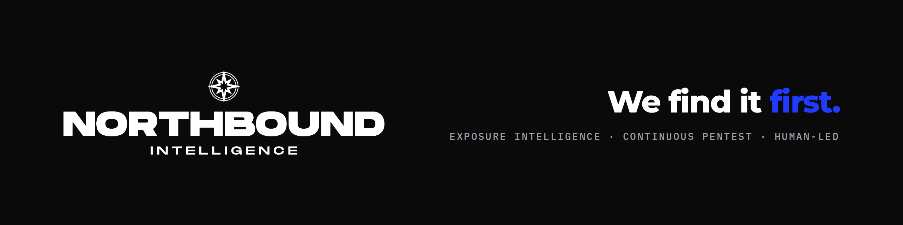

  

**NorthBound Intelligence** is a human-led exposure intelligence and continuous penetration testing firm.

We look at your organization the way an attacker would, from the outside: forgotten subdomains, exposed code and secrets, leaked credentials, misconfigured services, files you deleted that the internet kept. We find it first, prove what can be proven, and tell you what to fix.

### How we work

- **Continuous, not once a year.** Your external surface is monitored and tested on an ongoing basis.
- **Proof, not noise.** Every finding is labeled for what it is: confirmed by evidence, validated, or still a signal.
- **People decide.** AI assists with speed and reporting. Our experts direct and correct it.
- **Verified scope, signed reports.** We verify domain ownership before active testing, and reports are digitally signed and verifiable.

### Use it from your AI agent

[**northbound-mcp**](https://github.com/NB-INT/northbound-mcp) connects Claude Code, Cursor, VS Code and other MCP clients to NorthBound Sentinel: see your exposed surface, read findings with evidence and fix guidance, pull signed reports and launch governed assessments on domains you own. Available on every plan, including the free plan.

### In Security We Trust

Our public advisory series. When a serious vulnerability lands in widely used software, we publish what happened, who is affected, what to do in ten minutes and what is still unknown. Severity is always quoted with its issuer.

---

[Website](https://northboundintelligence.com) · [LinkedIn](https://www.linkedin.com/company/145447776/) · [Report a vulnerability](https://northboundintelligence.com/security/) · contact@northboundintelligence.com

*What would we find about you?*
